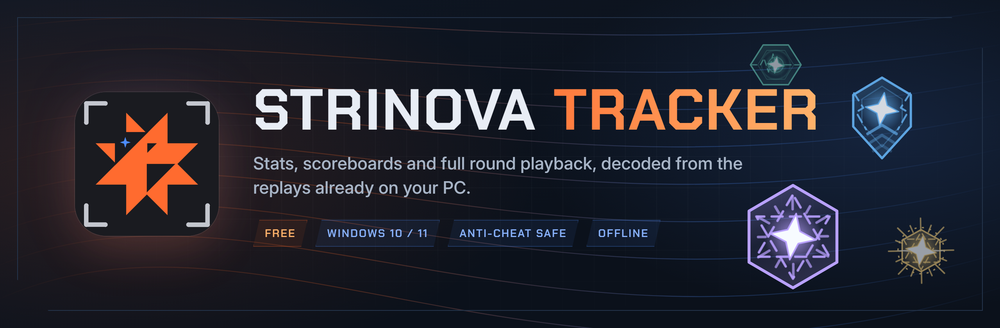

 

**A desktop stats tracker for Strinova.** It reads the match replays the game saves on your PC
and turns them into a profile, a match history, full scoreboards and a round-by-round 2D theater.
Nothing is uploaded, and the game itself is never touched.

### [⬇ Download the latest installer](https://github.com/x-mori/strinova-tracker-release/releases/latest)

---

## Features

<table>
<tr>
<td width="50%" valign="top">

### 📊 Profile
Current and peak **Ranked** and **Challenge** ranks on a whole-ladder strip, win rate, K/D, ADR,
KAST, first kills, multi-kills, plants and defuses. Top characters, maps and weapons, where your
hits land (head / body / legs), and the people you play with and against. Filter by mode and season.

</td>
<td width="50%" valign="top">

### 🗂️ Match history
Every archived match grouped by day, with result, score, map, character and K/D/A.
Filter by mode, map, character or achievement. Overtime matches are tagged.

</td>
</tr>
<tr>
<td valign="top">

### 🏆 Full scoreboards
Score, K / knock-downs / D / A, ADR, damage, headshot hits, first kills and deaths, multi-kills
and KAST for all ten players, with ranks, characters played, team average ranks and match
achievements such as clutches and aces.

</td>
<td valign="top">

### 🎯 Performance and duels
One player's match in depth: damage dealt and taken against each opponent, the weapons and
skills used, an Attack / Defense split, stats per character, and the team-vs-team kill matrix.

</td>
</tr>
<tr>
<td valign="top">

### 🎬 Round theater
Replay any round on the minimap: player positions and trails, HP and armor, weapons and ammo,
grenade and skill areas, awakenings, bomb carrier, plant and defuse countdowns, revives and a
timed kill feed. Scrub, change speed or go full screen.

</td>
<td valign="top">

### 💰 Economy
Each team's bank, loadout value and spending per round, plus every player's credits and the
upgrades they bought.

</td>
</tr>
<tr>
<td valign="top">

### 🗺️ Maps and characters
Every map with its minimap, optional callouts, and a heatmap of where you get kills and where you
die. Character pages show art, skills and awakenings from the Strinova Wiki next to your own stats.

</td>
<td valign="top">

### 📦 Replay archive
The game only keeps its 50 newest replays. The tracker copies every new one into its own archive
and can download your older replays the game still lists, so your history keeps growing.

</td>
</tr>
</table>

### ✨ NOVA Impact EXPERIMENTAL

An optional per-round impact score in Momentum Units (MU), built from kills, trades, objectives,
utility and round outcomes. Each match earns an animated tier emblem. It's off by default:
turn it on in **Settings → Appearance → Show NOVA Impact**.

---

## Install

1. Download **`StrinovaTracker-Setup-<version>.exe`** from the [latest release](https://github.com/x-mori/strinova-tracker-release/releases/latest).
2. Run it. It installs for your Windows user only, so no administrator rights are needed.
3. Windows SmartScreen may warn about an unrecognized app, because the installer isn't code-signed.
   Click **More info → Run anyway**. You can check the file against the SHA-256 checksum in the release notes.

### Requirements

- Windows 10 or 11, 64-bit
- [Microsoft Edge WebView2 Runtime](https://developer.microsoft.com/microsoft-edge/webview2/), which Windows 11 already includes
- Strinova installed on the same PC

### Getting started

1. Open Strinova Tracker. It finds the game's `Saved` folder automatically. If you moved it,
   set it in **Settings → Strinova Saved folder**.
2. Play. To get a replay for a match, download it from the match history in-game. The tracker
   picks up new replays within a minute or so.
3. Your accounts are detected from the replay file names. Switch between them in **Settings**.

> [!NOTE]
> Stats only cover matches that have a replay on your PC. The game doesn't keep a replay for every match.

---

## Anti-cheat safety

Strinova Tracker is built to stay out of the anti-cheat's way. It **never** opens, reads, writes
or injects into the game process, and never touches game memory or the game's network traffic.

It only:

- reads replay files and the game's settings save file (for its list of replay download links)
- takes the Windows process list, the same thing Task Manager shows, to see whether the game is running
- reads the Windows UDP connection table, which is OS-wide like `netstat`, for the optional "in a match" indicator
- downloads your own replays from Strinova's replay server, and public game data and icons

> [!IMPORTANT]
> This is a fan-made tool, provided as is. No third-party tool can promise how a game's anti-cheat
> will behave, so use it at your own risk. See the [terms](TERMS.md).

## Privacy

Everything stays on your PC in `%LOCALAPPDATA%\StrinovaTracker`. There are no accounts, no telemetry
and no analytics. The only internet use:

| Where | Why |
| --- | --- |
| `replay-download.strinova.com` | your own replays the game lists |
| [strinova.org](https://strinova.org/wiki/) | character, map, weapon and rank data and art |
| [lihaohong6/Strinova-data](https://github.com/lihaohong6/Strinova-data) | map, rank and upgrade tables |
| [stringify.gg](https://stringify.gg) | Challenge tier icons, downloaded once |

## Uninstall

Remove it from **Windows Settings → Apps**. Your archive and settings stay in
`%LOCALAPPDATA%\StrinovaTracker`. Delete that folder to remove them too.

---

## FAQ

<b>Some of my matches are missing</b>

The tracker can only read matches that have a replay file. Download the replay from the in-game
match history and it will appear shortly. Replays older than about 30 days are deleted from
Strinova's servers and can't be downloaded any more.

<b>Why can't I see my Strinovium points?</b>

Replays and the game's local files record your Ranked division but not the points inside it.
The tracker shows your exact division on the ladder instead of guessing a number.

<b>Is the source code available?</b>

No. This repository hosts the official releases, the changelog and issue reports.

<b>I found a bug or have an idea</b>

Please [open an issue](https://github.com/x-mori/strinova-tracker-release/issues/new/choose).
The app's log, `%LOCALAPPDATA%\StrinovaTracker\tracker.log`, helps a lot with bugs.

---

## Credits

- [Strinova Wiki](https://strinova.org/wiki/): character, map, weapon and item data and art. Wiki text is CC BY-SA 4.0.
- [lihaohong6/Strinova-data](https://github.com/lihaohong6/Strinova-data): the game tables the wiki is built from.
- [stringify.gg](https://stringify.gg): Challenge tier icons.
- [StrinovaHUB](https://strinovahub.com/): inspiration for the round theater.
- [Chakra Petch](https://fonts.google.com/specimen/Chakra+Petch) and [Inter](https://rsms.me/inter/) fonts, under the SIL Open Font License.

 

Made by **Fujimori** · [fujiverse.dev](https://fujiverse.dev)

Strinova Tracker is unofficial and isn't made, endorsed or supported by iDreamSky, the Strinova
developers or the Strinova Wiki. Strinova and all related names, characters, art and logos belong to their owners.

